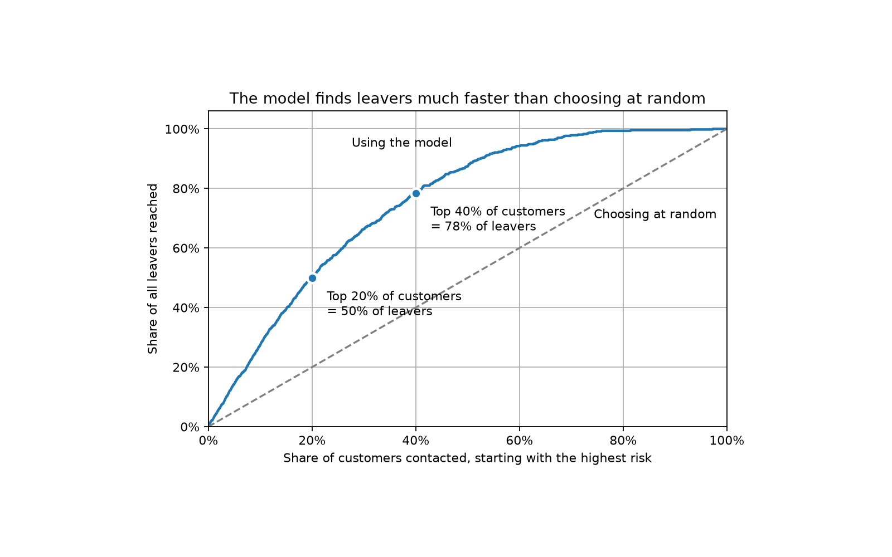
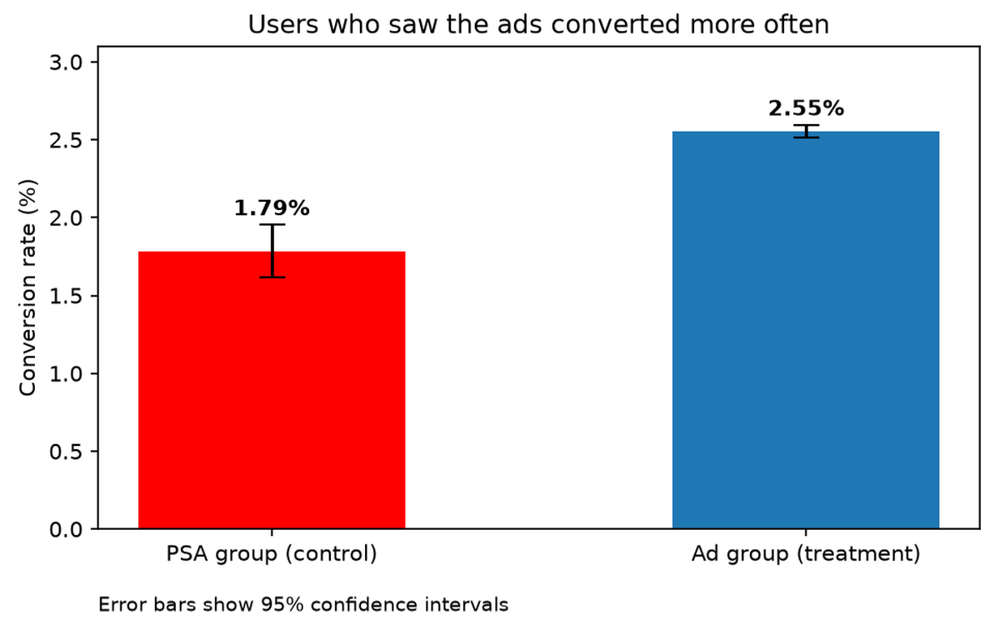
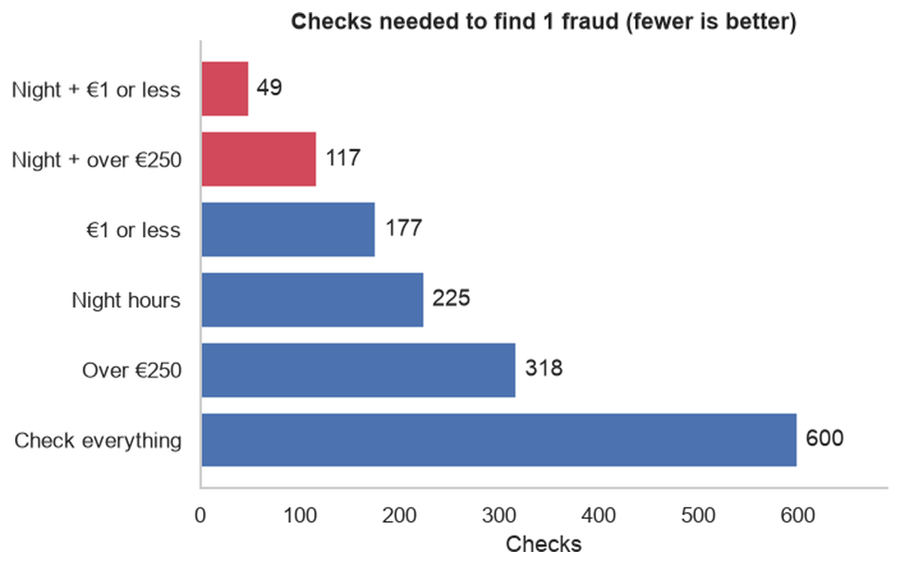
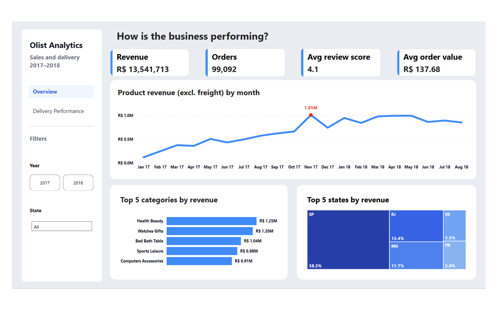

<!-- ───────────── HEADER BANNER ───────────── -->

<!-- ───────────── TYPING LINE ───────────── -->

  

<!-- ───────────── CONTACT BADGES ───────────── -->

  
  
  

---

## About me

I'm a data analyst based in the Netherlands. I started my career in fraud analytics, digging through large-scale transaction and behavioral data to work out which activity didn't belong. That's where I found the part of this job I enjoy most: spotting a pattern in the data, checking that it's real and explaining it so the team actually does something different the next week.

AI is part of how I work, in two ways. I build machine-learning models when a problem needs one: fraud detection, root-cause analysis, text analysis of patents. And I use AI assistants like Claude Code to explore data and write code faster, while checking every number myself before it reaches a stakeholder. I also like automating the repetitive parts of the job, like daily reporting, so the team can spend its time on the questions that matter.

I'm now looking for my next analyst role in the Netherlands: **data analyst, BI analyst or fraud/risk analyst.**

<table>
  <tr>
    <td><b>Based in</b></td><td>The Netherlands, open to roles anywhere in the country</td>
  </tr>
  <tr>
    <td><b>Education</b></td><td>MSc Business Intelligence &amp; Smart Services, Maastricht University (2025) MEng Industrial Engineering &amp; Systems Management (Data Analytics), American University of Armenia (2023)</td>
  </tr>
</table>

---

## Toolbox

  
  
  
  
  

  
  
  
  
  
  

  
  
  
  
  

**Methods I'm comfortable with:** AI-assisted analysis · A/B testing · churn modelling · customer segmentation · fraud rules and alerting · explainable ML (SHAP) · topic modelling

---

## Where I've worked

**Fraud Analyst · Digitain · 2022–2023**
I worked in the Fraud & Operations team, analyzing large-scale transactional and behavioral data with SQL, Excel and Power BI to spot suspicious patterns and financial risks. I investigated suspicious and unauthorized activity, built 5+ Power BI dashboards to track fraud trends and operational KPIs, and automated daily fraud and KPI reporting, replacing a manual spreadsheet process.

<b>Applied projects with industry partners (click to expand)</b>

 

- **Tipico** (2025): compared an XGBoost fraud model against a rule-based baseline on behavioral and transaction data, then used SHAP so the fraud team could see why the model flagged someone.
- **VMware** (2022): built an explainable AI (XAI) prototype that points engineers to the likely root cause of cloud application failures, using ~6,000 traces. → [code](https://github.com/lilitpghs/cloud-root-cause-analysis)
- **Maastricht University** (2025): topic modelling (LDA, BERTopic, NMF) on 3,000+ generative AI patents to track how the technology is evolving.

---

## Featured projects

Each project starts from a business question and ends with a recommendation and an honest list of what the data can't tell you. They all use public datasets, so you can rerun them.

<table>
  <tr>
    <td width="50%" valign="top">
      
      <h3>Customer churn &amp; retention</h3>
      
        
      <i>Who should get a retention offer, and is it worth it?</i>  
      Offering only where expected value beats cost earns <b>~3.4× the profit</b> of offering to everyone, at 40% of the cost.
    </td>
    <td width="50%" valign="top">
      
      <h3>Marketing A/B test</h3>
      
        
      <i>Did the ads actually work?</i>  
      Yes, a <b>+43% lift</b> (p &lt; 0.001). But only ~30% of conversions were caused by the ads, so counting them all overstates the campaign 3×.
    </td>
  </tr>
  <tr>
    <td width="50%" valign="top">
      
      <h3>Credit card fraud</h3>
      
        
      <i>Which simple alert rule should a fraud team start with?</i>  
      Night-time payments of €1 or less catch <b>1 fraud per 49 checks</b>, against 1 in 600 when checking at random.
    </td>
    <td width="50%" valign="top">
      
      <h3>Olist sales &amp; delivery dashboard</h3>
      
        
      <i>How is the business doing, and where is delivery failing?</i>  
      Black Friday pushed on-time delivery below 90%. Northern states wait <b>twice as long</b> as the national average.
    </td>
  </tr>
</table>

  <b>More:</b>
  <a href="https://github.com/lilitpghs/online-retail-customer-segments">Online retail segments</a> ·
  <a href="https://github.com/lilitpghs/cloud-root-cause-analysis">Cloud root cause analysis (VMware)</a>

---

## Currently exploring

- Where AI tools genuinely speed up analysis, and where a human still has to check the numbers
- Explainable AI: making model decisions understandable to business teams
- How companies turn data into automated reporting and decisions

<!-- ───────────── FOOTER WAVE ───────────── -->

